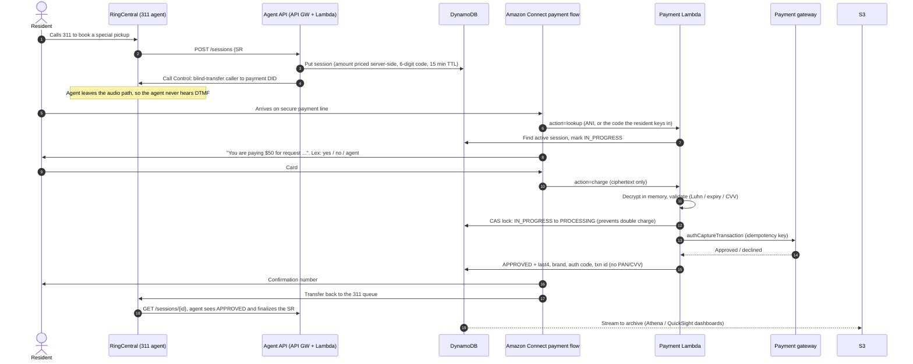

# Architecture & design decisions

City of Wilmington 311: secure in-call payment for special trash pickup.
POC built against the Accelance solution deck. Target platform: **AWS** (deck slides 9 and 15).

## 1. End-to-end flow

## 2. Key decisions (and where the POC deliberately departs from the deck)

| # | Decision | Why |
|---|---|---|
| D1 | **Add Amazon Connect to the architecture.** The deck's AWS diagram routes the call straight from RingCentral to Lex. | Lex has no phone number and cannot answer a PSTN/SIP call. Something has to terminate the transferred call: Amazon Connect (recommended) or Chime SDK SIP Media Application. Connect also adds per-minute telephony and DID costs that the $300–500/month estimate on slide 21 does not include. |
| D2 | **Card digits are captured with Connect "Store customer input" + encryption, not Lex slots.** Lex handles only the non-sensitive conversational turns (confirm amount, help, "agent"). | Lex conversation logs, transcripts and session attributes would put the PAN and CVV in places that are hard to control. With Connect encryption, the digits are ciphertext everywhere except inside the payment Lambda (`connect_crypto.py`). |
| D3 | **Agent does a blind transfer, not a conference.** | If the agent stays conferenced, they can hear the DTMF tones, which puts agent desktops and RingCentral call recordings in PCI scope. Recording must also be disabled on the Connect payment flow. |
| D4 | **Amount is priced server-side from a fee schedule.** | The agent UI never sends a dollar amount, which prevents tampering and typos. The fee values in `config.py` are **placeholders** until Public Works confirms them. |
| D5 | **Caller matched by ANI, with a 6-digit one-time code as fallback.** | RingCentral may not keep the original caller ID on transfer (depends on account settings). The code is single-use, expires after 15 minutes, and the caller gets 3 tries. |
| D6 | **Compare-and-set state machine plus an idempotency key per attempt.** | One in-flight charge per session, ever. Retries after a decline are allowed (max 3); retries after a *gateway error* are not, because the outcome is unknown. Those sessions go to `FAILED` for manual reconciliation. |
| D7 | **Gateway behind a port (`gateway/base.py`).** | The City has not chosen a processor yet (slide 25). The POC ships a mock and an Authorize.Net sandbox adapter. |
| D8 | **AWS only.** | The deck shows both AWS and Azure diagrams. The Azure version puts Azure OpenAI in the payment path; card data must never reach an LLM. Pick one cloud before Discovery closes. |

## 3. PCI DSS scope: an honest view

"No card data stored" does **not** mean "out of PCI scope". Any system that *processes or transmits* card data is in the cardholder data environment (CDE).

| Component | In scope? | Notes |
|---|---|---|
| RingCentral / agent desktop | **Out**, if D3 holds | Agent drops off before card entry. Verify that recording and monitoring do not follow the caller. |
| Amazon Connect payment flow | **In** (AWS is a PCI DSS Level 1 service provider) | Encrypted input. Recording, transcripts and Contact Lens are disabled for this flow. |
| `ConnectPaymentFunction` Lambda | **In** | Decrypts and transmits the PAN. Keep it small, isolated, with reserved concurrency and least-privilege IAM. |
| Agent API, DynamoDB, S3, dashboards | Connected-to / out | They hold only last4, brand, auth code and transaction ID. |

**Scope-reduction alternative to raise in Discovery:** some processors and vendors (PCI Pal, Paymentus, Eckoh, the processor's own IVR) offer a DTMF-masking or hosted-IVR service where card digits never reach City-owned code. This costs more per transaction but takes the Lambda out of the CDE. The gateway port (D7) keeps that option open.

## 4. Data model (DynamoDB `cow311-payment-sessions-<env>`)

| Attribute | Example | Notes |
|---|---|---|
| `session_id` (PK) | uuid4 | |
| `payment_code` (GSI) | `451973` | One-time code |
| `caller_ani` + `created_at` (GSI) | `+13025550123` | E.164 |
| `service_request_id` | `SR-2026-555001` | |
| `amount_cents`, `line_items` | `7500` | Integer cents only |
| `status` | `PENDING → IN_PROGRESS → PROCESSING → APPROVED / DECLINED / FAILED / CANCELLED / EXPIRED` | |
| `attempts`, `decline_reason` | | |
| `card_brand`, `card_last4`, `auth_code`, `gateway_transaction_id` | `VISA`, `1111` | Allowed under PCI DSS |
| `ttl` | epoch + 90 days | Archived to S3 by the stream before expiry |

## 5. Security controls implemented in the POC

- `CardData` masks itself in `repr`/`str`, so it cannot be logged by accident. IVR buffers are wiped after every charge, re-entry or exit.
- A log redaction filter scrubs any 13–19 digit run, and Connect parameter maps have sensitive keys masked (`redaction.py`). This is tested.
- `APP_ENV=prod` refuses to start with the mock gateway or plaintext input decryption (`config.py`).
- KMS customer-managed key (rotation enabled) on DynamoDB and S3. The S3 bucket is TLS-only with public access blocked.
- JWT authorizer on the agent API, with throttling. The Connect Lambda can be invoked only by the Connect instance.
- One-year log retention and an error alarm on the payment Lambda.

## 6. POC → production gap list

1. Real Connect flow plus Lex bot built in the City account (spec: [CONNECT_FLOW.md](CONNECT_FLOW.md)).
2. RingCentral: confirm Call Control API access, how ANI behaves on transfer, and the agent-UI embedding (RingCentral Embeddable / CRM widget).
3. **Return path:** "transfer back to the queue" may land the caller with a *different* agent. Options: route to the originating agent's direct extension (store it on the session), or use a priority "payment return" queue.
4. Refunds and voids (slide 25 open question): add an agent-initiated void within the same settlement day.
5. Create/update the 311 case in the CRM (the Azure slide shows Salesforce) when status becomes `APPROVED`.
6. Load test at 3× the peak call volume. Pen test plus a QSA review of the CDE boundary.
7. Reporting: Athena tables over the S3 archive, plus QuickSight or the City BI dashboards.

## 7. Notes on the deck itself (fix before it goes to the City)

- **Timeline vs. plan:** the phase durations on slide 19 add up to **14–19 weeks** sequentially, but slide 20 promises "maximum ~14 weeks". Either show the phases overlapping or restate the window.
- **Cost total:** the staffing math on slide 20 checks out (890 hrs, $49,140). Slide 21 should add Amazon Connect telephony (per-minute charges plus a DID) and possibly a PCI assessment.
- **Copy-paste text:** slide 22 says "Wilmington's **ERP** modernization", which comes from another proposal.
- **Blank slide:** slide 11 is empty.
- **Two clouds:** both AWS (slide 9) and Azure (slide 10) are shown. State one recommendation (see D8).
